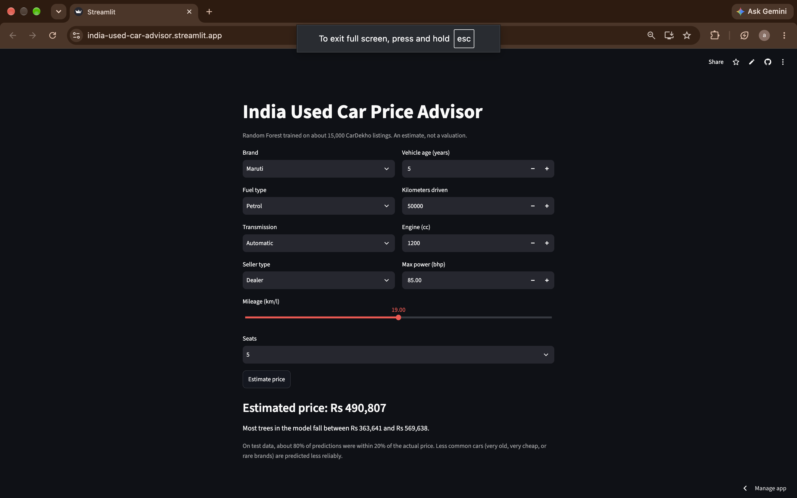

# India Used Car Advisor

Predicting used car prices in the Indian market using data analysis and machine learning.

**Live app:** https://india-used-car-advisor.streamlit.app



## Status
- [x] Load and clean the data
- [x] Exploratory analysis and charts
- [x] Feature engineering (log price, one-hot encoding)
- [x] Train and compare models
- [x] Error analysis
- [x] Streamlit app deployed
- [ ] AI layer (plain-language input)

## Data
CarDekho used car dataset from Kaggle (manishkr1754/cardekho-used-car-data), about 15,400 listings.
Cleaning: removed duplicates, rows with 0 seats, km_driven above 500,000, and rows where km_driven equals selling_price (likely data-entry errors). 15,213 rows remain.

## Approach
- Target: log of the selling price (prices are heavily right-skewed).
- Features: vehicle age, km driven, mileage, engine, max power, seats, plus one-hot encoded brand, fuel type, seller type and transmission.
- 80/20 train/test split.

## Model comparison (initial run, held-out test set)

| Model | R2 (log price) | RMSE (log) | MAE (Rs) |
|---|---|---|---|
| Random Forest (200 trees) | 0.932 | 0.177 | 107,177 |
| Gradient Boosting | 0.921 | 0.191 | 126,935 |
| Linear Regression | 0.893 | 0.222 | 146,626 |

## Final model (used in the app)
Random Forest with 150 trees and min_samples_leaf=3, chosen to keep the saved model small (about 18 MB). On the held-out test set: R2 of 0.935, median absolute error of 9.9%, and 80.6% of predictions within 20% of the actual price. The deployed model is refit on all the data.

## Limitations
- A few listings have inconsistent age, mileage or specs, which hurts predictions. Removing 12 rows with implausible km per year changed R2 by about 0.002, so they were kept.
- Very old, cheap cars are under-represented, and the model tends to overestimate their prices.
- The data is a single snapshot from one source and does not capture city, condition or market trends.
- Gradient Boosting was not tuned.

## Run locally
```bash
python3 -m venv venv
source venv/bin/activate
pip install -r requirements.txt
streamlit run app/app.py
```
